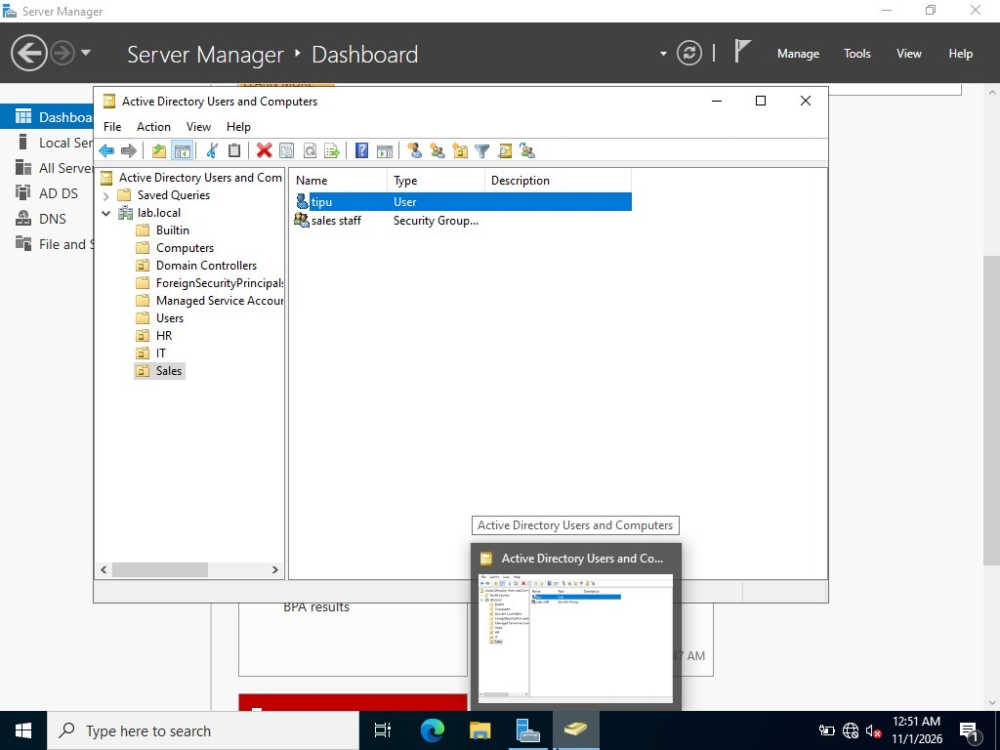
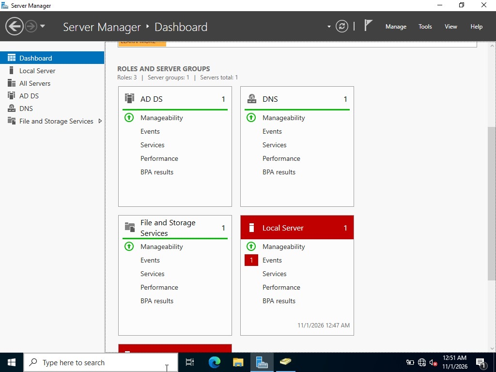
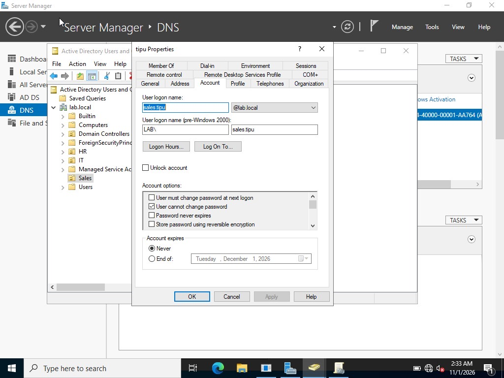
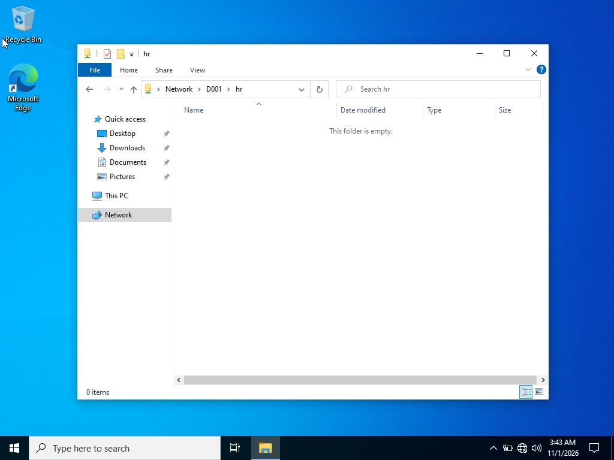
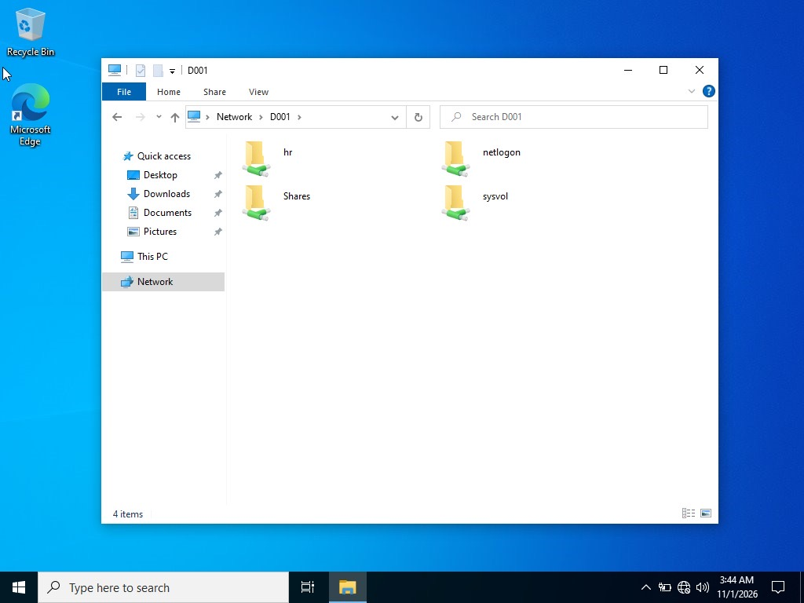
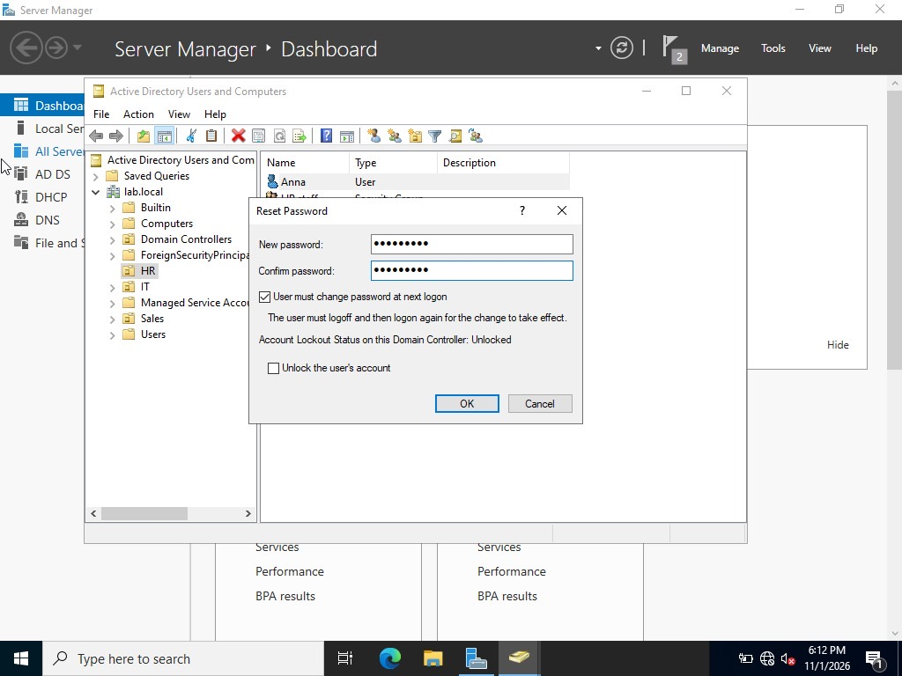

# Lab 1: Windows Server Active Directory

## Goal
Build a small Windows domain from scratch and manage users, groups, shares and policy the way a help desk / junior sysadmin would.

## Environment
- Windows Server 2022 (Desktop Experience) VM, hostname `D001`
- Windows 10 client VM joined to the domain
- Domain: `lab.local`

## Steps completed

### Server and domain
1. Installed Windows Server 2022 with Desktop Experience in VirtualBox and named it `D001`.
2. Installed the **AD DS** and **DNS** roles and promoted the server to a domain controller for `lab.local`.
3. Confirmed healthy roles in Server Manager (AD DS, DNS, File and Storage Services).

### Organisation structure
4. Created Organizational Units: **HR**, **IT**, **Sales**.
5. Created a user (**Anna**) and the security group **HR staff** in the HR OU.
6. Created the user `sales.tipu` and the security group **sales staff** in the Sales OU.

### Client
7. Built a Windows 10 client VM on the same internal network and joined it to `lab.local`.
8. Logged in to the client with a domain account (`hr.anna`).

### File share
9. Created an HR share on the server and confirmed it opens from the client as `\\D001\hr`.
10. Confirmed the other shares visible on the server (`Shares`, `netlogon`, `sysvol`).

### Group Policy
11. Created a Group Policy Object named **Block-Control-Panel** and linked it to the Sales OU.
12. Tested the policy on a Sales user and confirmed Control Panel was blocked.

### Account management
13. Reset a user password in ADUC and ticked **User must change password at next logon**.
14. Reviewed account options on a Sales user (**User cannot change password** enabled).

## Verification
- HR share opened from the client over the network.
- Domain user signed in on the domain-joined client.
- Group Policy applied to the Sales OU.

## Screenshots

**Sales OU with a user and a security group**

**Server Manager roles: AD DS, DNS, File and Storage Services**

**Account tab options on a Sales user**

**HR share opened from the client**

**Shares visible on D001 from the client**

**Resetting a user password (must change at next logon)**

## What I learned
- OUs are what Group Policy gets linked to; users and groups inside them inherit the policy.
- A share can be reachable but empty: reachable proves connectivity and permissions, not content.
- Reset passwords with "change at next logon" so the admin never knows the user's real password.
