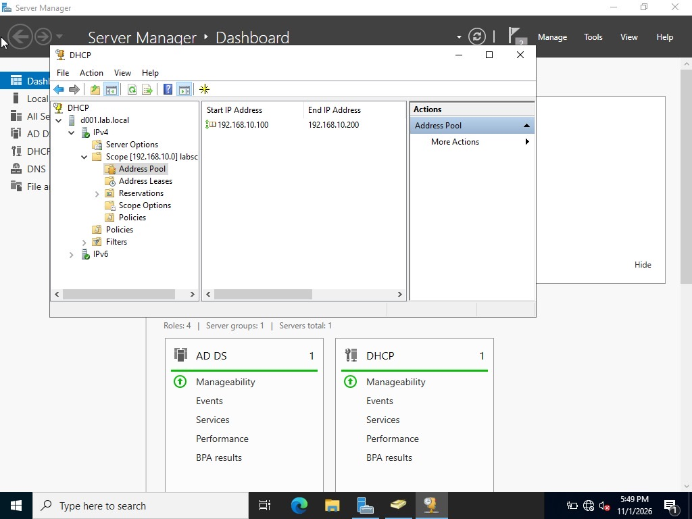
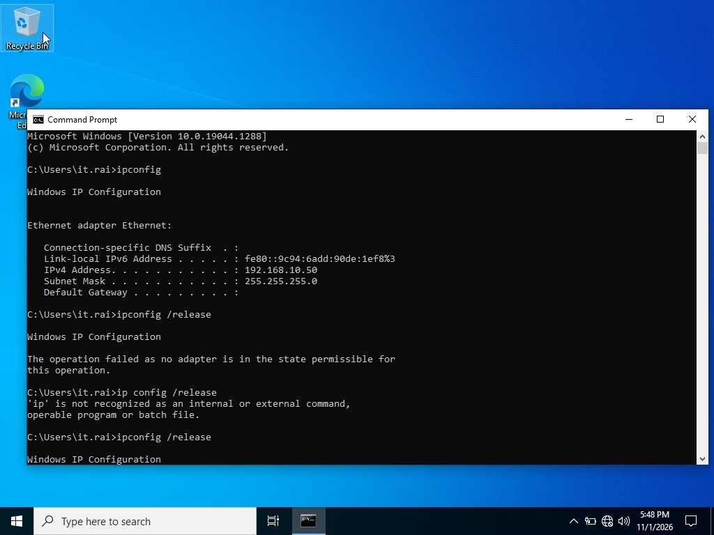
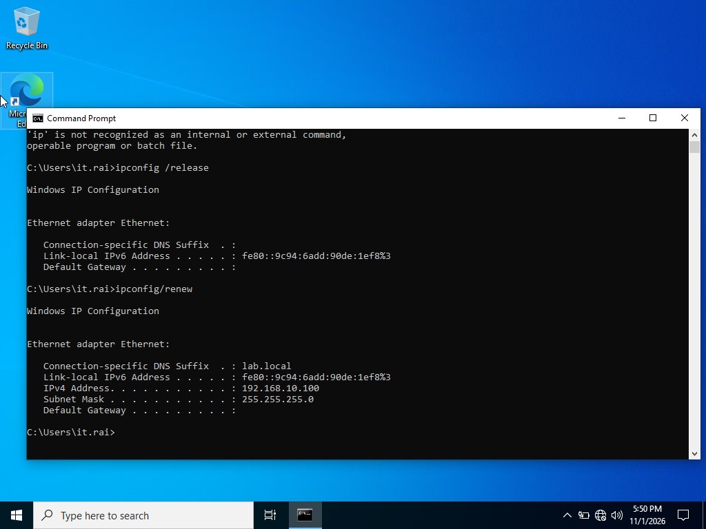
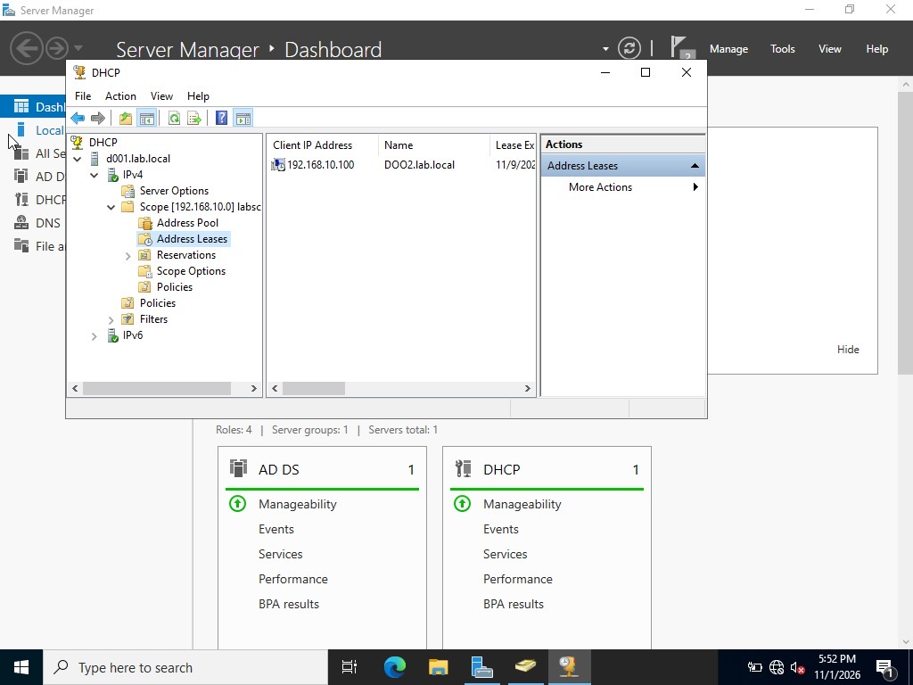
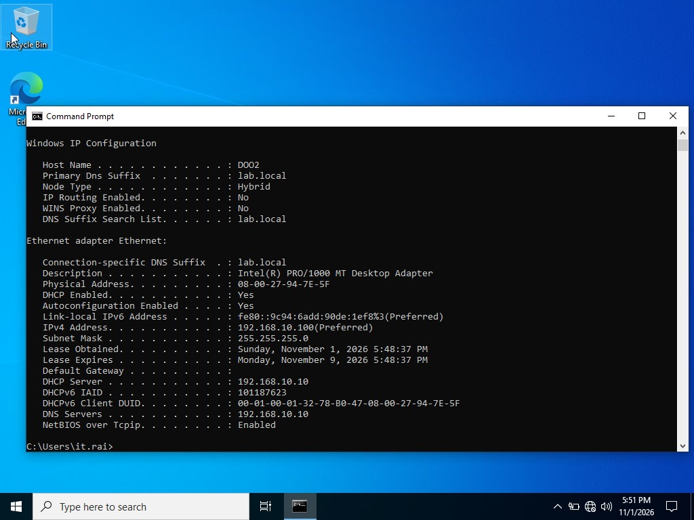
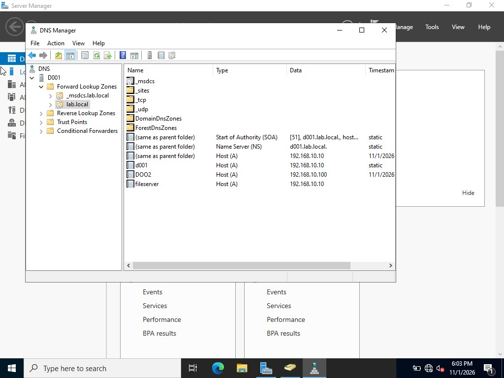
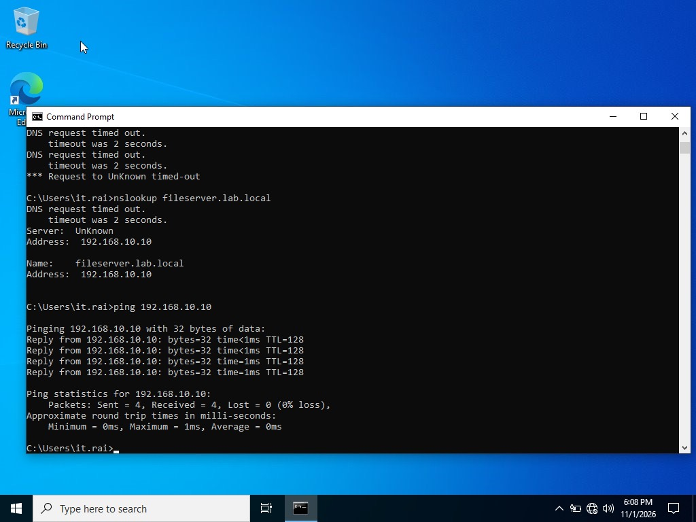
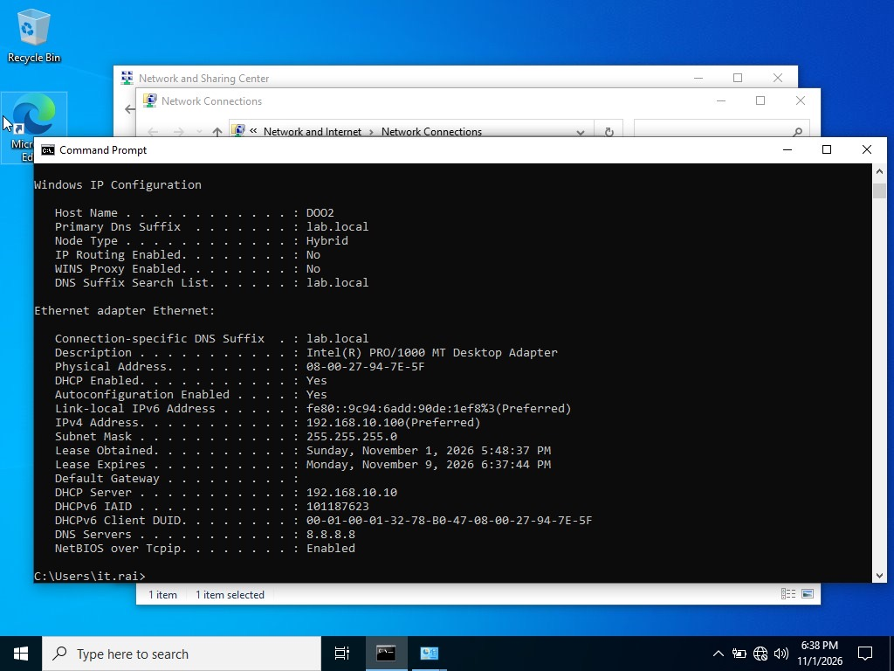
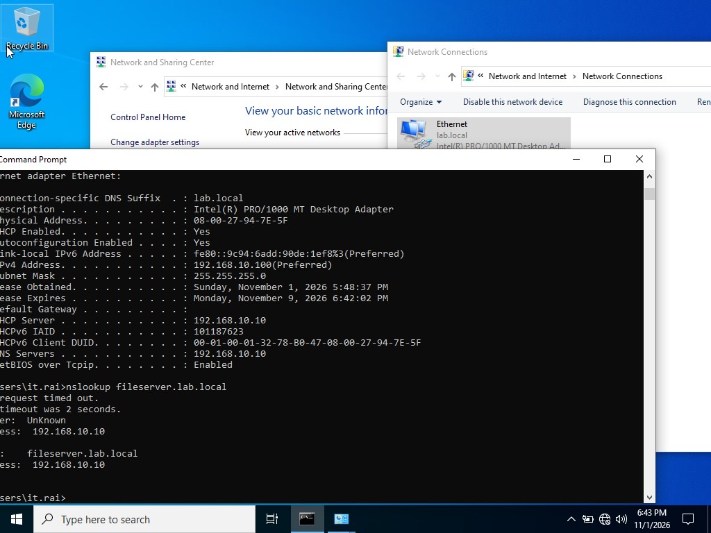

# Lab 2: DHCP and DNS Troubleshooting

## Goal
Add DHCP to the domain controller, prove a client gets an address and DNS from it, and practise the network troubleshooting commands a help desk uses every day.

## Environment
- Server `D001` (`192.168.10.10`, static): AD DS, DNS, DHCP
- Windows 10 client `DOO2`
- Network `192.168.10.0/24`, no default gateway (isolated lab)

## Part A: DHCP

### Setup
1. Installed the **DHCP** role on `D001` (Server Manager now shows 4 roles).
2. Created an IPv4 scope for `192.168.10.0` with an address pool of **192.168.10.100 to 192.168.10.200**.
3. Scope hands out DNS `192.168.10.10` and the domain suffix `lab.local`.

### Client test
4. Client started with a static address (`192.168.10.50`). Ran `ipconfig /release`, which failed (see Problem 1 below).

5. Switched the client adapter to obtain an IP address automatically.
6. Ran `ipconfig /release` then `ipconfig /renew`. The client received `192.168.10.100` and the `lab.local` suffix.

7. Confirmed on the server: DHCP > Scope > **Address Leases** shows `192.168.10.100` leased to `DOO2.lab.local`.

8. Confirmed on the client with `ipconfig /all`: DHCP Enabled = Yes, DHCP Server = `192.168.10.10`, DNS Server = `192.168.10.10`, lease valid for 8 days.

## Part B: DNS

9. Opened DNS Manager on `D001` and reviewed the forward lookup zone `lab.local` (SOA, NS, `d001`, `DOO2` registered by the client).
10. Created a host (A) record: `fileserver` = `192.168.10.10`.

11. Tested from the client:
    - `nslookup fileserver.lab.local` resolved to `192.168.10.10`
    - `ping 192.168.10.10` returned 4 of 4 replies, 0% loss

## Part C: Simulated fault, wrong DNS server

12. On the client adapter, set the DNS server to `8.8.8.8` (a public DNS server that knows nothing about `lab.local`). `ipconfig /all` confirmed the change.

13. Fixed it by setting DNS back to `192.168.10.10`, then re-ran `ipconfig /all` and `nslookup fileserver.lab.local`. The name resolved again.

## Problems and fixes

| # | Symptom | Cause | Fix |
|---|---------|-------|-----|
| 1 | `ipconfig /release`: "The operation failed as no adapter is in the state permissible for this operation." | Adapter had a static IP, so there is no DHCP lease to release | Set adapter to obtain IP automatically, then release/renew |
| 2 | `ip config /release`: "'ip' is not recognized as an internal or external command" | Typed `ip config` (two words). Windows command is `ipconfig` | Use `ipconfig /release` |
| 3 | `nslookup`: "DNS request timed out", "Server: UnKnown", yet the name still resolves | nslookup first does a reverse lookup of its own DNS server's IP. No PTR record / reverse zone exists, so it times out and shows UnKnown. Forward lookups still work | Ignore for a lab, or create a reverse lookup zone with a PTR record for `192.168.10.10`. Confirm real connectivity with `ping` |
| 4 | Client cannot resolve internal names | DNS server set to `8.8.8.8`, which cannot resolve `lab.local` | Point DNS to the domain controller `192.168.10.10` |

See also the full [troubleshooting log](troubleshooting-log.md).

## What I learned
- `ipconfig /release` only works on a DHCP-assigned adapter.
- For an AD domain, clients must use the domain controller as DNS, not a public resolver.
- Test in layers: `ping` the IP (network), then `nslookup` the name (DNS), then open the resource (service).
