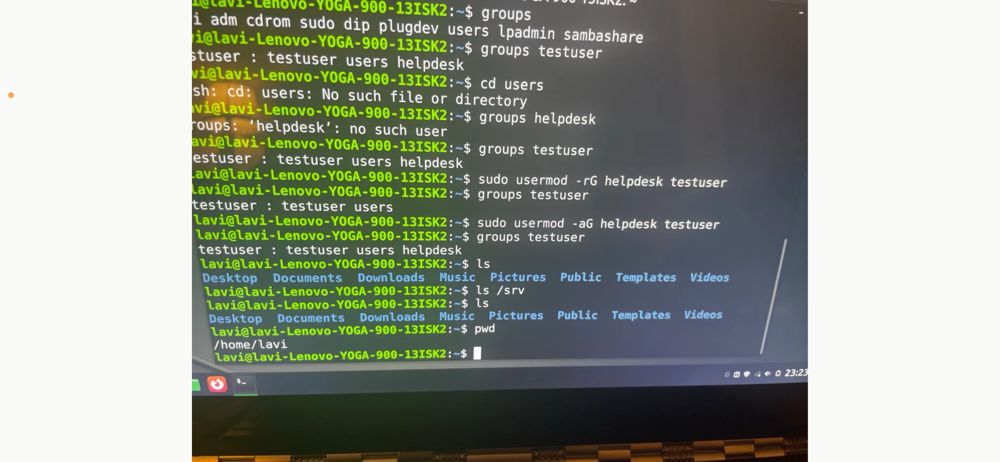
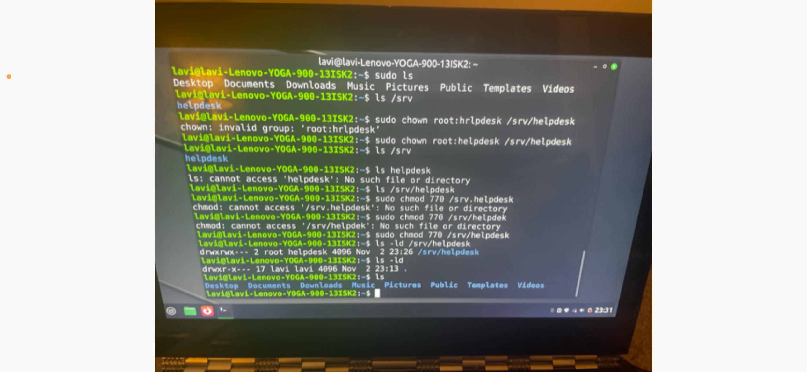
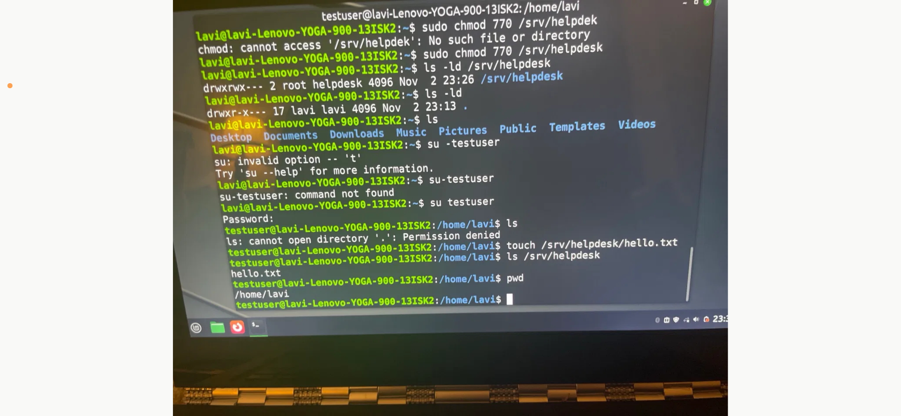
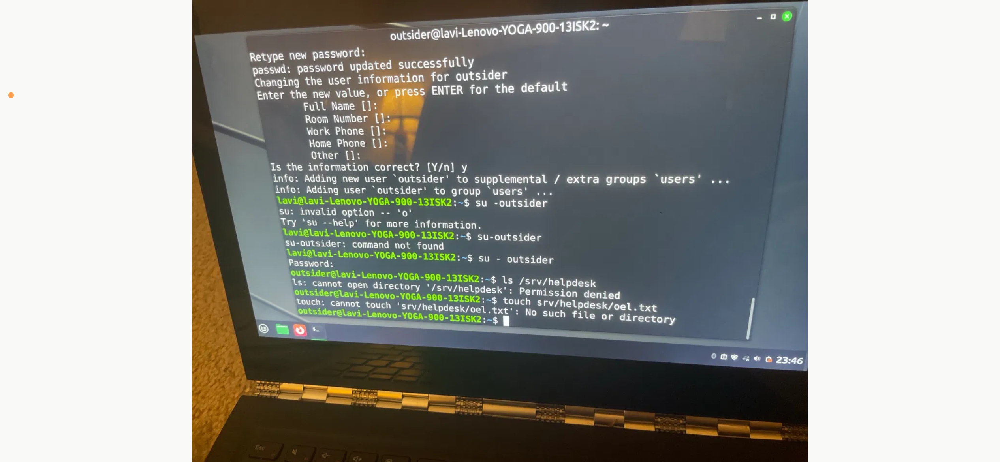
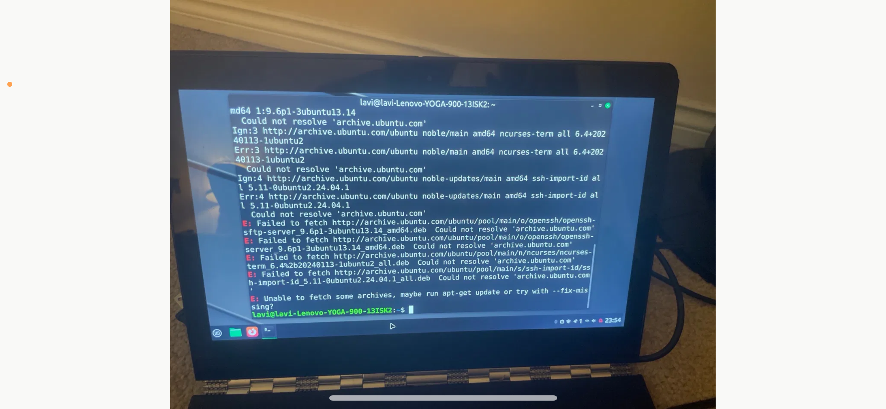
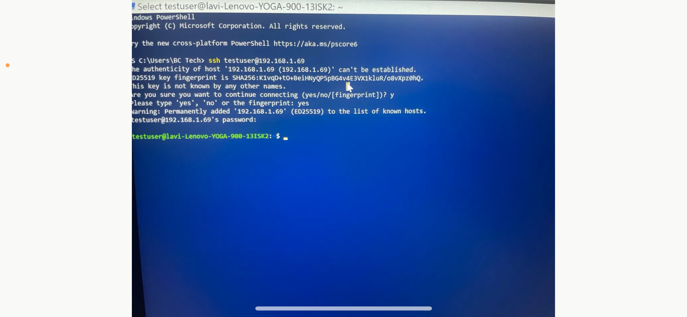
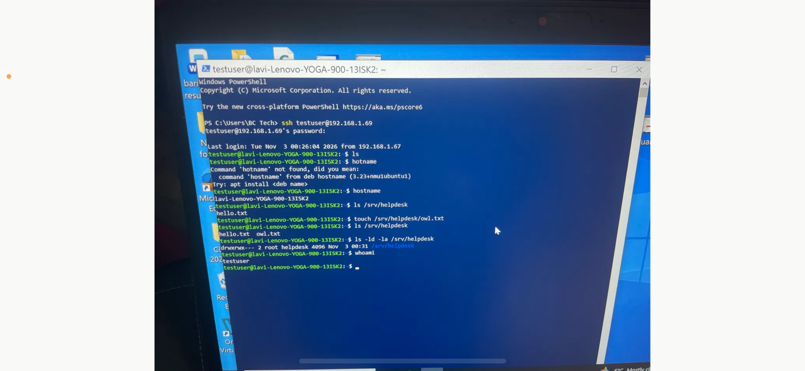
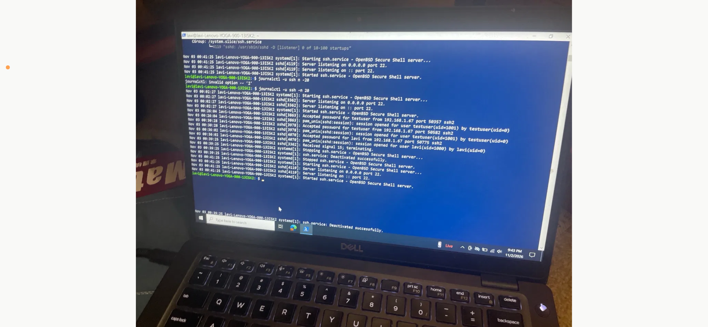

# Lab 3: Linux Users, Permissions and SSH

## Goal
Practise the Linux tasks a help desk or junior admin gets asked to do: create users and groups, lock a shared folder down to one group, prove who can and cannot access it, connect remotely over SSH, and read service logs.

## Environment
- Linux Mint laptop (Ubuntu 24.04 base) as the server
- Windows 10 PC with PowerShell as the SSH client
- Shared folder: `/srv/helpdesk`

## Steps completed

### Users, groups and the shared folder
1. Created a group `helpdesk` and a user `testuser`.
2. Added `testuser` to `helpdesk` and verified with `groups testuser` (`testuser users helpdesk`).
3. Created `/srv/helpdesk` and set ownership and permissions:
   ```bash
   sudo chown root:helpdesk /srv/helpdesk
   sudo chmod 770 /srv/helpdesk
   ls -ld /srv/helpdesk        # drwxrwx--- 2 root helpdesk
   ```
4. Created a second user, `outsider`, who is **not** in `helpdesk`:
   ```bash
   sudo adduser outsider
   ```

### Access tests
5. As `testuser` (in `helpdesk`): created a file in the share, which worked:
   ```bash
   su - testuser
   touch /srv/helpdesk/hello.txt
   ls /srv/helpdesk
   ```
6. As `outsider`: listing the share was **blocked**:
   ```bash
   su - outsider
   ls /srv/helpdesk            # Permission denied
   ```

### Group membership change
7. Removed `testuser` from the group, confirmed it, then added them back:
   ```bash
   sudo usermod -rG helpdesk testuser    # remove from group
   groups testuser                       # testuser users
   sudo usermod -aG helpdesk testuser    # add back (-a = append)
   groups testuser                       # testuser users helpdesk
   ```

### SSH
8. Installed and started the SSH server (see Problem 1, the install initially failed on DNS).
9. First connection from the Windows PC:
   ```powershell
   ssh testuser@<linux-ip>
   ```
   Accepted the host key fingerprint by typing the full word `yes`.
10. Inside the SSH session ran `ls`, `hostname`, `whoami` and `ls -ld -la /srv/helpdesk`, and created `owl.txt` in the share as `testuser` to prove group write access over SSH.

### Services and logs
11. Checked the service with `systemctl status ssh` (active, listening on port 22).
12. Read the last 20 log lines: `journalctl -u ssh -n 20`.
    The journal shows the service starting, accepted password logins for `testuser` and the admin account, then "Received signal 15; terminating" followed by a clean stop and start. That is a service restart recorded in the log.

## Screenshots

**Group membership: remove and re-add with usermod**


**chown / chmod typos, then the correct commands and result**


**Switching to testuser and writing to the share**


**Outsider is denied access**


**apt install failed: could not resolve host**


**First SSH connection and host key prompt**


**SSH session from Windows PowerShell**


**journalctl output for the ssh service**


## Problems and fixes
See the table in the [troubleshooting log](troubleshooting-log.md#linux). Summary: nearly every error was a typo, a missing space or a missing leading `/`, plus one real DNS/connectivity failure during `apt install`.

## What I learned
- `770` on a folder owned by `root:helpdesk` means owner and group get full access, everyone else gets none.
- `usermod -aG` appends a group; without `-a` the user's other groups are replaced.
- `su - user` (with the dash and a space) gives a proper login shell in that user's home.
- `groups` takes a *username*; to inspect a group use `getent group helpdesk`.
- `journalctl -u <service> -n 20` is the quickest way to see what a service has been doing.
