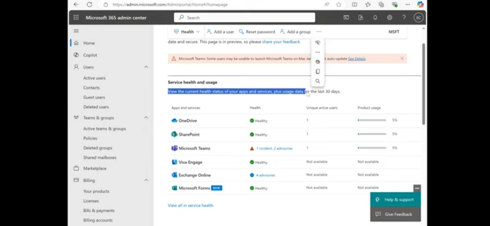
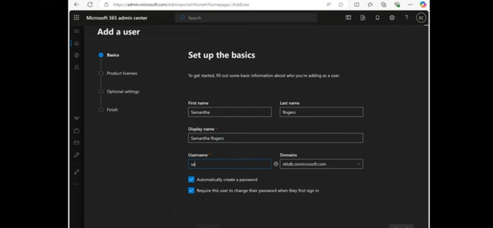
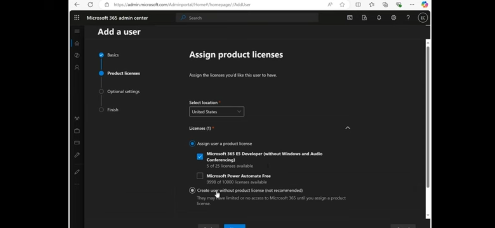
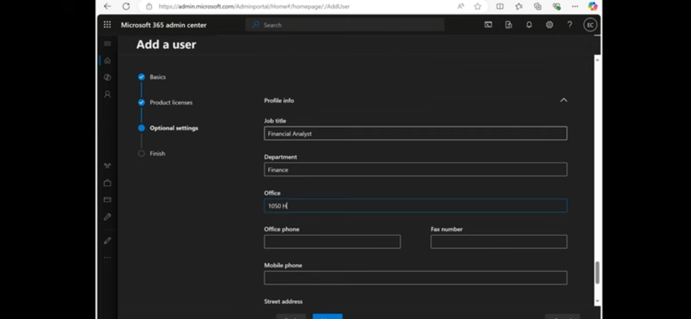
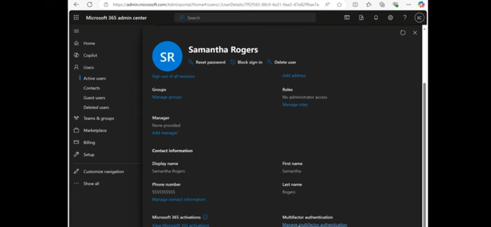
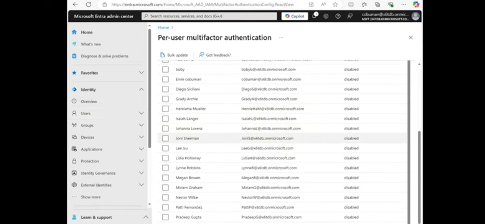
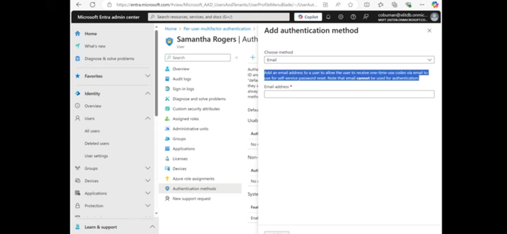

# Lab 4: Microsoft 365 Admin Center (Free Developer Tenant)

## Goal
Get hands-on with the cloud side of user management: the Microsoft 365 admin center and Microsoft Entra ID. I used the free Microsoft 365 E5 Developer tenant.

## Steps completed

### 1. Check service health
Opened the admin center home page and reviewed **Service health and usage**: OneDrive, SharePoint, Viva Engage and Forms were healthy; Teams showed 1 incident and 2 advisories; Exchange Online showed 4 advisories. First thing a help desk checks when several users report the same problem.

### 2. Create a user
**Users > Active users > Add a user**
- Name: Samantha Rogers, display name `Samantha Rogers`
- Username on the tenant's `onmicrosoft.com` domain
- **Automatically create a password** and **Require this user to change their password when they first sign in** both ticked

### 3. Assign a license
- Selected location: United States (required before licensing)
- Assigned the **Microsoft 365 E5 Developer** license (5 of 25 available at the time)
- Noted that "create user without product license" is possible but not recommended, because the user would have limited or no access

### 4. Optional profile settings
Job title **Financial Analyst**, department **Finance**, office details.

### 5. Review the new user and admin actions
On the user page I reviewed the common help desk actions: **Reset password**, **Block sign-in**, **Delete user**, **Sign out of all sessions**, plus groups, roles (no administrator access), manager and contact information.

### 6. Multifactor authentication
Followed **Manage multifactor authentication** to the Microsoft Entra admin center, **Per-user multifactor authentication** page. All users showed status *disabled*.

### 7. Add an authentication method
On the user's **Authentication methods** blade I opened **Add authentication method** and chose **Email**. Key point from the portal text: email codes can be used for self-service password reset but **cannot** be used for sign-in authentication.

## What I learned
- New cloud users need a usage location before a license can be assigned.
- "Reset password", "Block sign-in" and "Sign out of all sessions" are the three quickest responses to a suspected compromised account.
- Email is a recovery method for SSPR, not a sign-in factor.
- Always check service health before troubleshooting a single user's problem.
