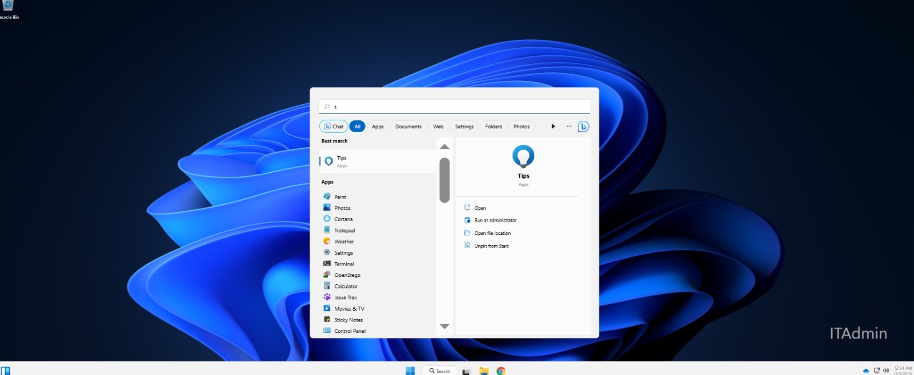
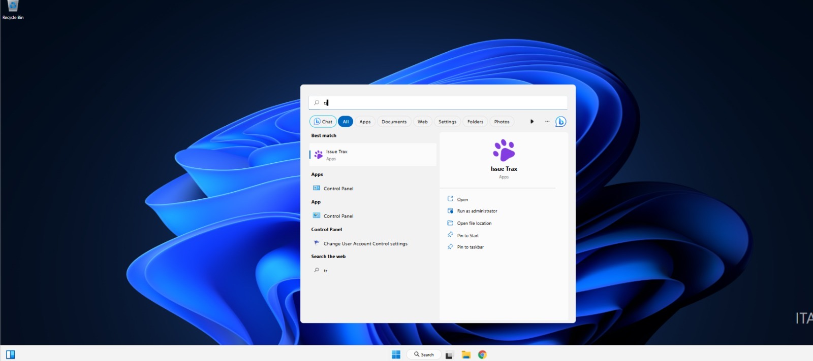
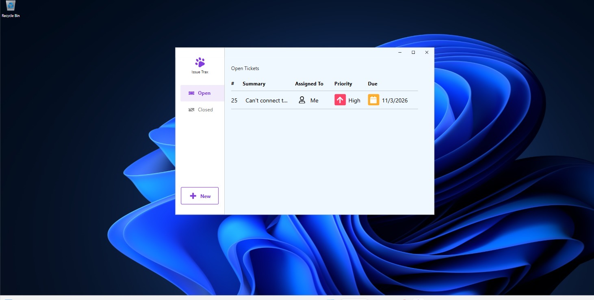
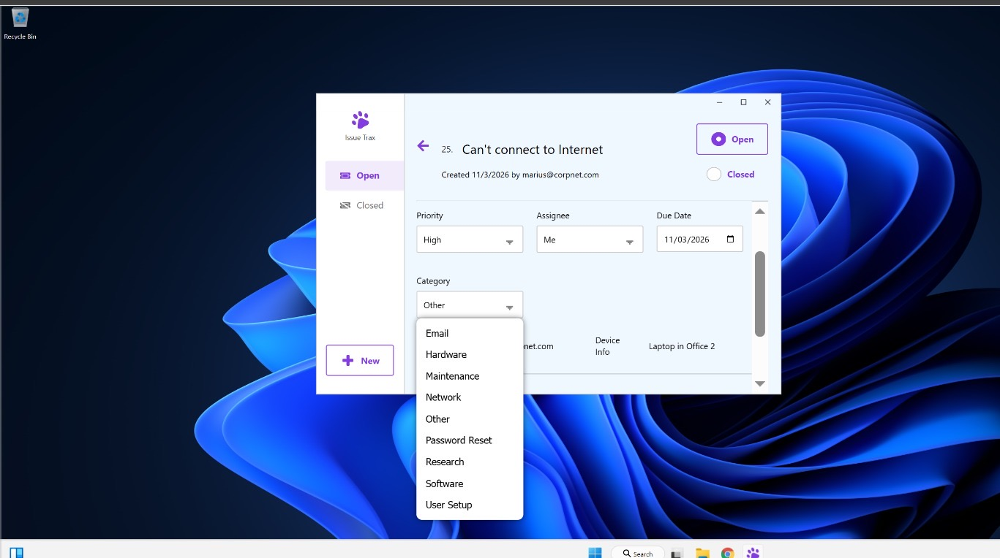
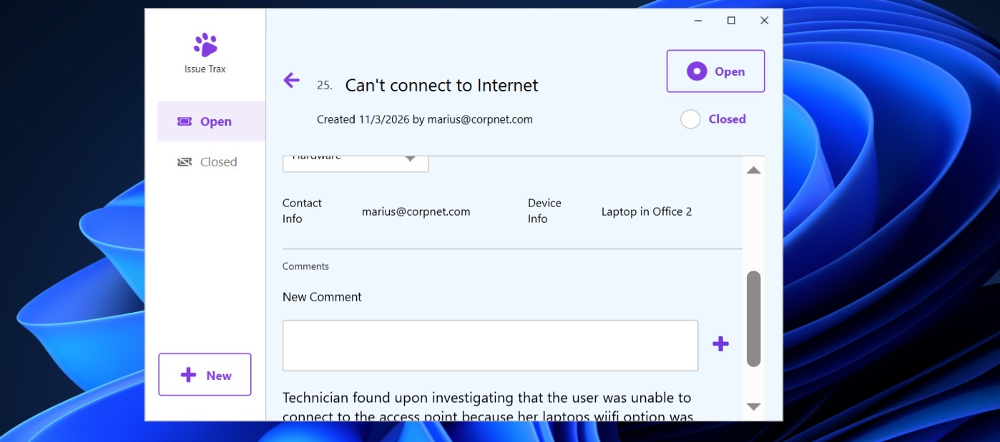
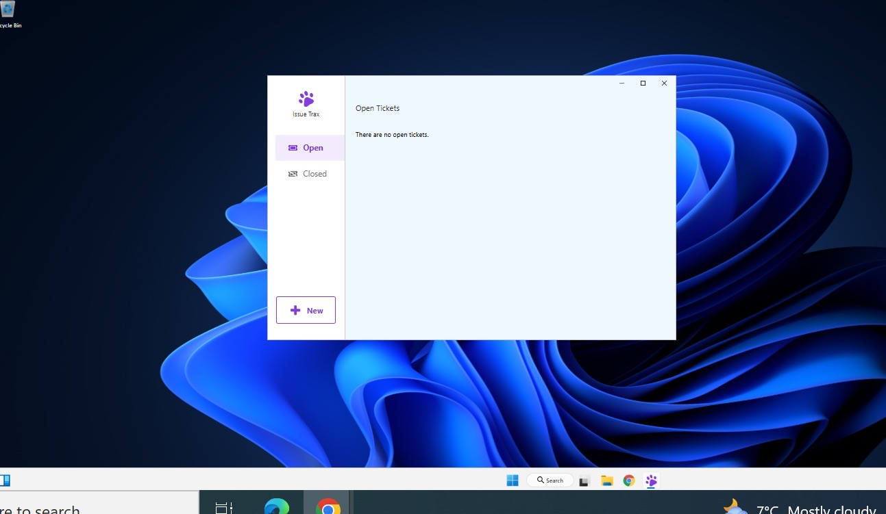
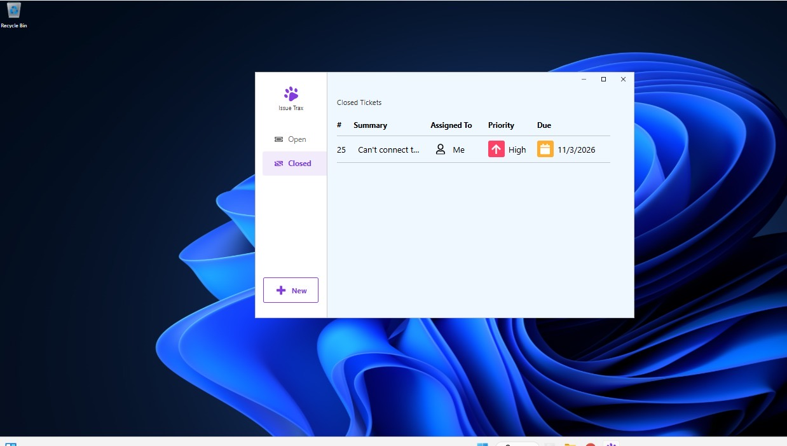

# Lab 5: Help Desk Ticketing (CertMaster Labs, Issue Trax)

## Goal
Work a support ticket through its full life cycle in a ticketing tool: find it, triage it, categorise it, document the fix and close it.

## Scenario
Ticket **#25: "Can't connect to Internet"**
- Reported by: marius@corpnet.com
- Device: Laptop in Office 2
- Priority: High, assigned to me, due 11/3/2026

## Steps completed

1. Opened the ticketing app from the Windows search box (typed `tr`, launched **Issue Trax**).

   
   

2. Reviewed the **Open Tickets** queue: ticket #25, priority High, assigned to me.

   

3. Opened the ticket and checked priority, assignee, due date, contact info and device info.
4. Chose the right **category** from the list (Email, Hardware, Maintenance, Network, Other, Password Reset, Research, Software, User Setup) and set it to **Hardware**, since the cause was on the user's laptop.

   

5. Added a **comment** documenting what the technician found: the user could not connect to the access point because of a Wi-Fi setting on her laptop.

   

6. Set the ticket status to **Closed**. The Open queue was then empty and the ticket moved to the Closed list.

   
   

## What I learned
- Good tickets record: who, what device, what was found, what was done.
- Category choice matters for reporting and routing.
- Always confirm the ticket moved to Closed and the queue is clean.
- For "can't connect to the internet" start with the simple things first: is Wi-Fi switched on, is the right network selected, then IP settings, then DNS.
