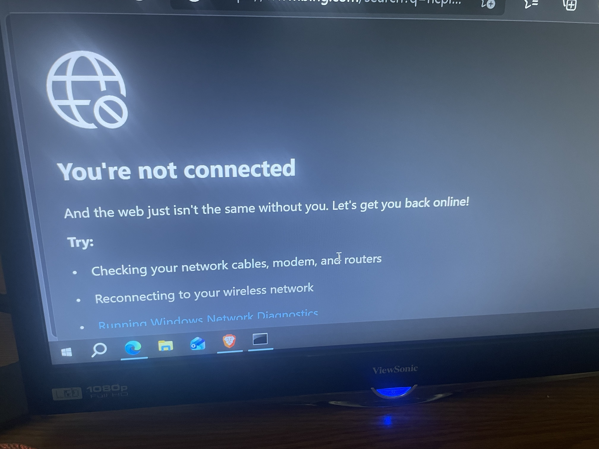
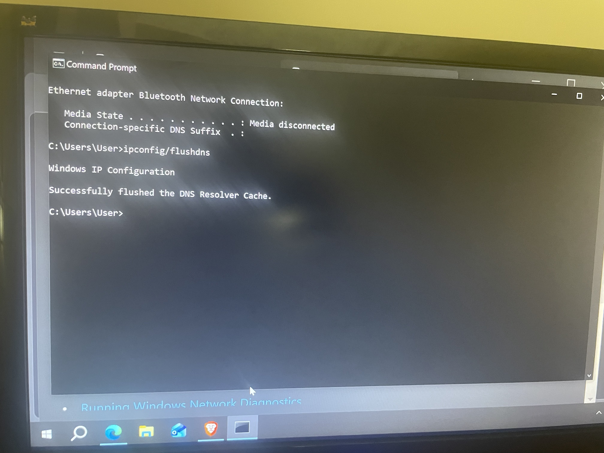
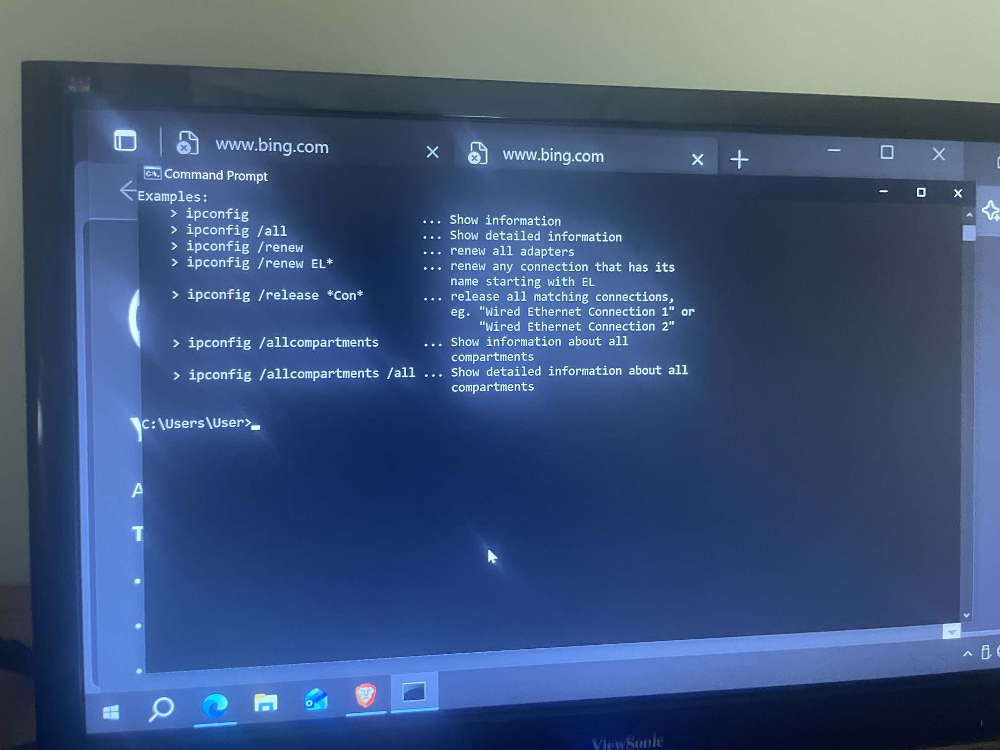

# Lab 7: Network / DNS Connectivity Troubleshooting

**Platform:** ServiceDesk Simulator
**OS:** Windows 10
**Skills:** Network troubleshooting, Command Prompt, DNS, IP configuration

## Scenario
The browser could not load websites and showed a **"You're not connected"** error page, even though the page suggested checking cables, modem and routers.

## Troubleshooting steps
1. **Reproduced the problem.** Opened the browser and searched/visited the lab website. The connection error appeared instead of the page.

   

2. **Checked the network adapters** in Command Prompt with `ipconfig`. The Bluetooth network adapter showed *Media disconnected*.

   

3. **Flushed the DNS resolver cache:**
   ```
   ipconfig /flushdns
   ```
   Result: *Successfully flushed the DNS Resolver Cache.*
4. **Released and renewed the IP address** to get a fresh lease:
   ```
   ipconfig /release
   ipconfig /renew
   ```
   I used `ipconfig /?` to review the available options.

   

5. **Re-tested** the browser and the connection was restored.

## Commands used
| Command | Purpose |
|---|---|
| `ipconfig` / `ipconfig /all` | View adapter and IP details |
| `ipconfig /flushdns` | Clear cached (possibly bad) DNS entries |
| `ipconfig /release` | Drop the current IP lease |
| `ipconfig /renew` | Request a new IP lease from DHCP |

## Result
Issue resolved. Connectivity restored after clearing the DNS cache and renewing the IP configuration.

## What I learned
- A "not connected" browser error can come from stale DNS or IP configuration, not only from physical problems.
- Work from simple to complex: check adapters, flush DNS, renew IP, then re-test.
