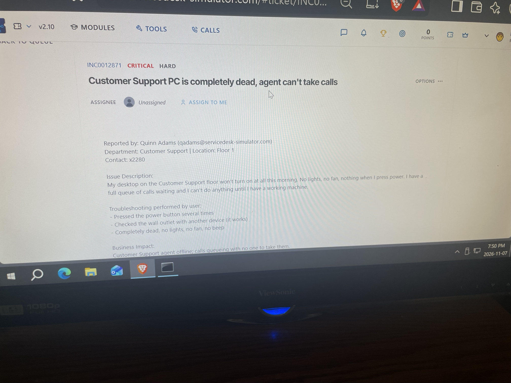
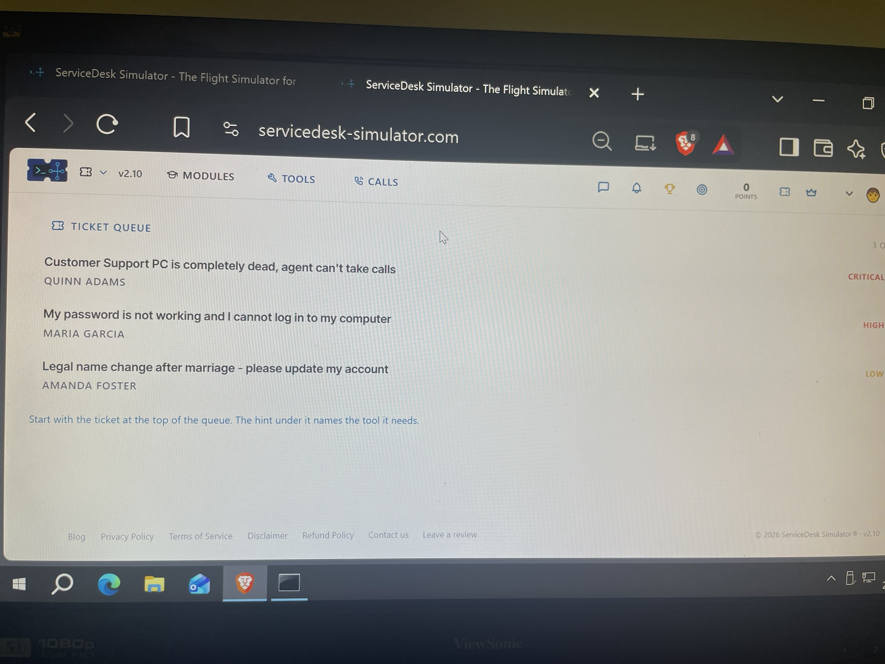
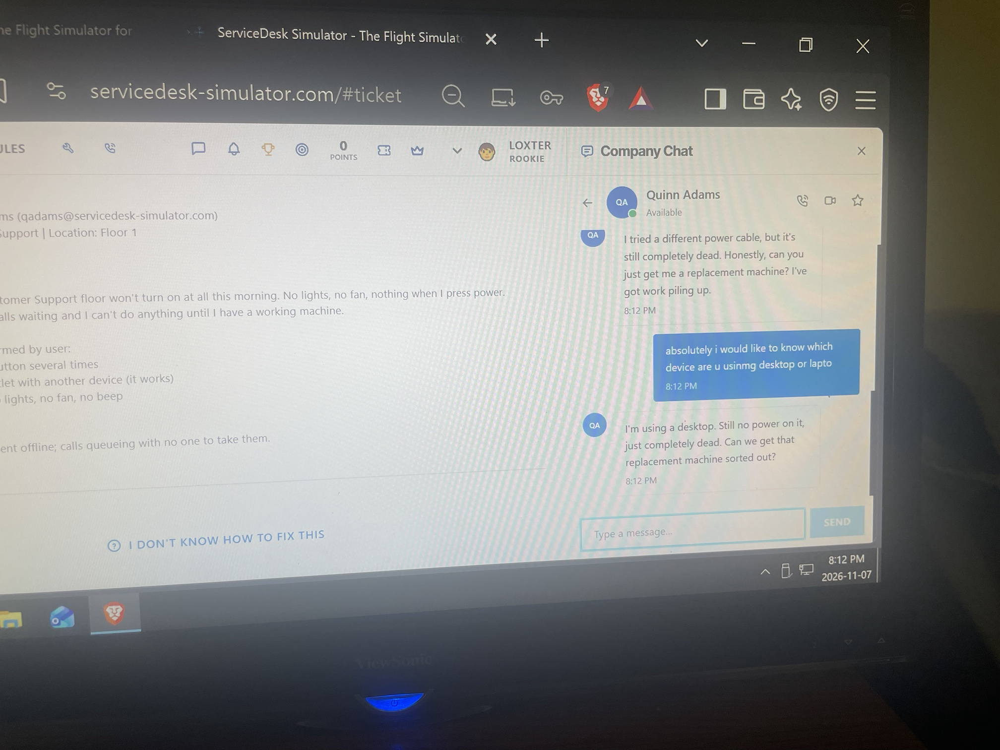
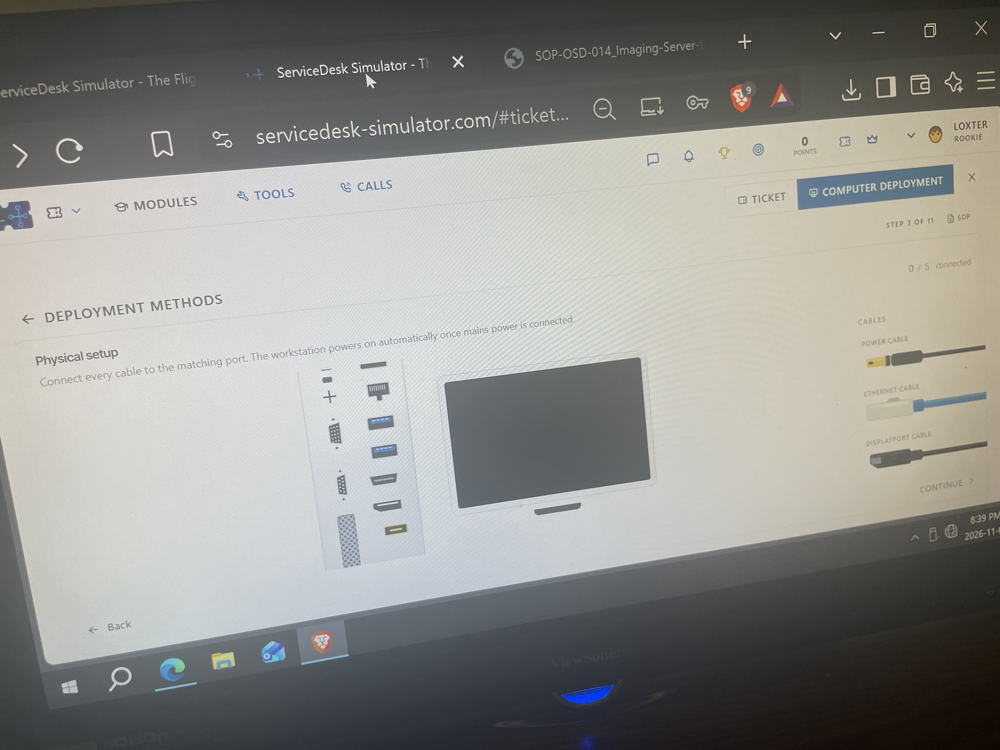
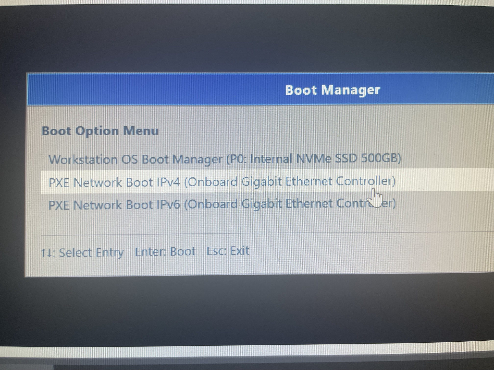
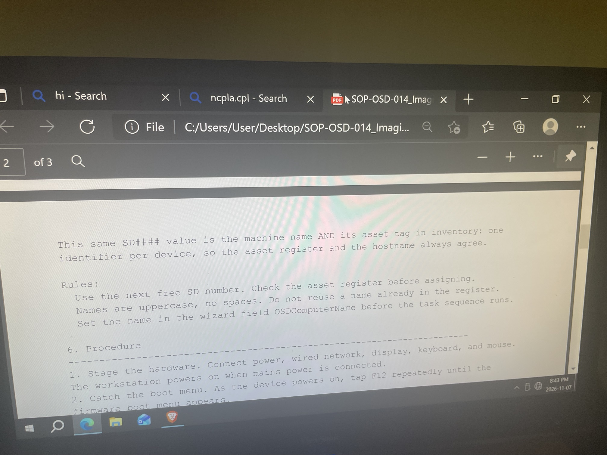
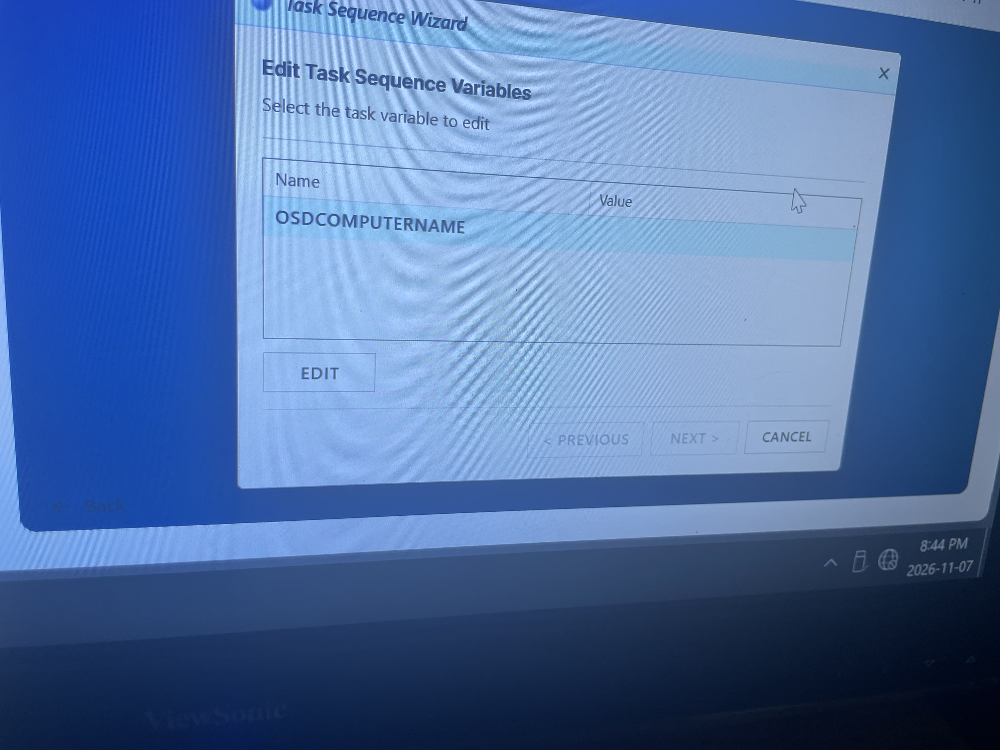
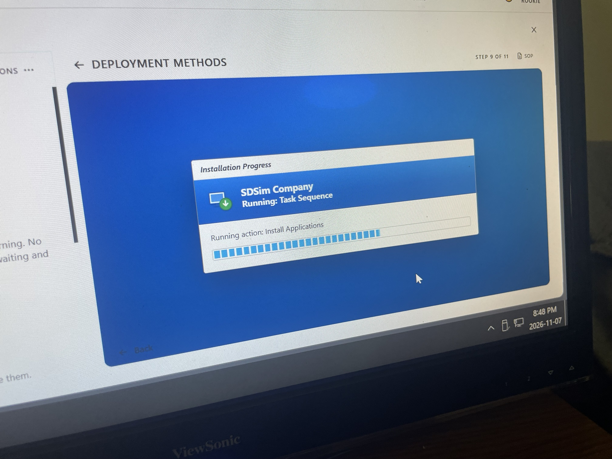
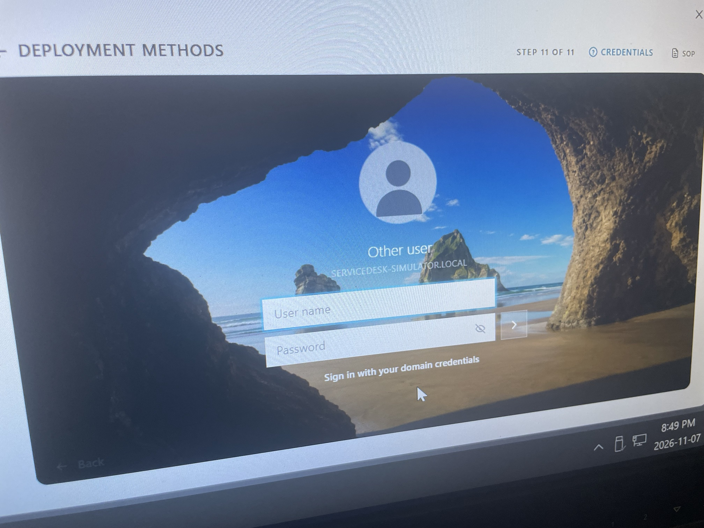
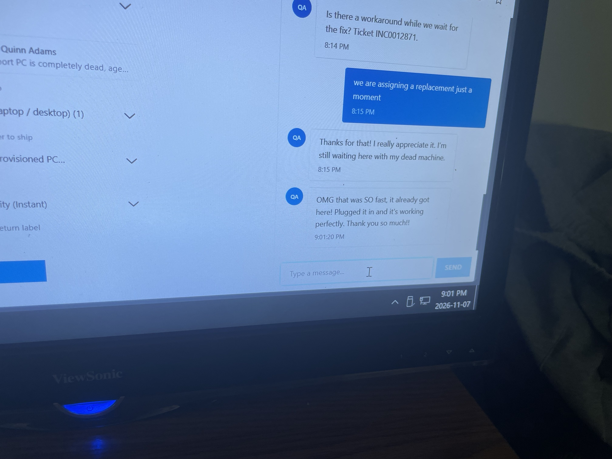

# Lab 8: Dead PC Ticket: Replacement and Network Image Deployment

**Platform:** ServiceDesk Simulator
**Ticket:** INC0012871 (Priority: Critical, Difficulty: Hard)
**Skills:** Ticket handling, user communication, hardware troubleshooting, asset management, PXE network imaging (task sequence), SOP compliance

## Scenario
Quinn Adams (Customer Support, Floor 1) reported that their desktop would not turn on at all: no lights, no fan, no beep. A full queue of calls was waiting, so the agent could not work.

## What I did
1. **Triaged the queue.** Took the Critical ticket at the top of the queue and assigned it to myself.

   

2. **Gathered information in Company Chat.** Confirmed the device was a desktop. The user had already tried a different power cable and the PC was still dead, so she asked for a replacement.

   

3. **Checked asset management for a spare.** No ready-to-ship PC was available, so I deployed a new image onto a machine.
4. **Staged the hardware** (power, network, display).

   

5. **Booted into PXE.** Pressed F12 for the boot menu and selected **PXE Network Boot IPv4**.

   

6. **Followed SOP-OSD-014 (Imaging Server).** Used the next free `SD####` name, uppercase with no spaces, and checked the asset register first so no name is reused.

   

7. **Set the computer name** in the Task Sequence Wizard variable `OSDCOMPUTERNAME`.

   

8. **Ran the task sequence.** The image deployed and applications installed.

   

9. **Verified the build.** The machine reached the domain login screen (`servicedesk-simulator.local`).

   

10. **Shipped the PC.** Collected the user's contact/shipping information, updated her in chat, and shipped the replacement.
11. **Confirmed with the user.** She received it, plugged it in and it worked.

   

## Result
Ticket resolved. The user received a working replacement and was back to taking calls.

## What I learned
- Critical tickets need fast, clear communication, because the user is blocked while waiting.
- Rule out simple causes first (outlet, power cable) before replacing hardware.
- Always follow the SOP and check the asset register so device names stay unique and inventory stays accurate.
- PXE network imaging with a task sequence lets you build a standard workstation without installation media.
